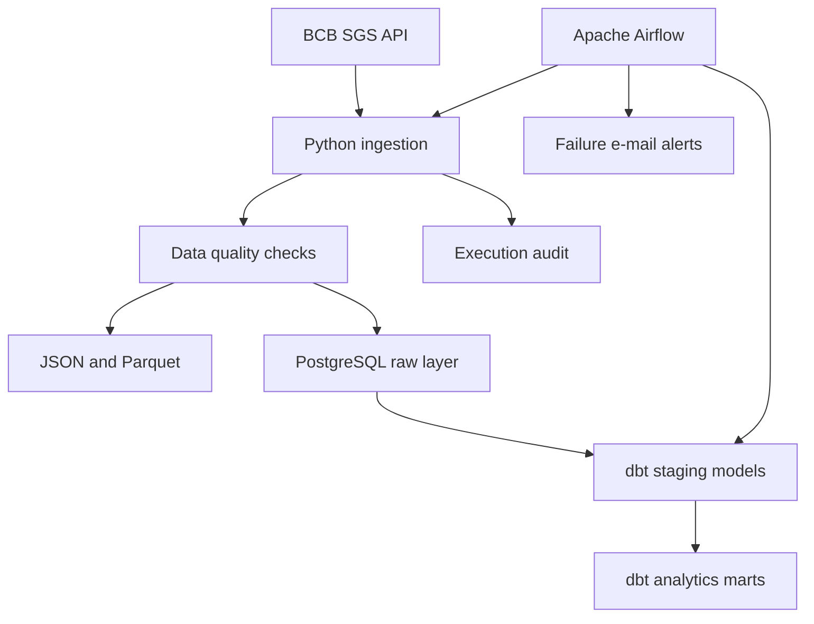

# Financial Data Pipeline

A local financial data platform that extracts public time series from the Brazilian Central Bank (BCB), validates and stores the data, and builds analytics-ready models with dbt.

The project demonstrates a complete data engineering workflow using Python, PostgreSQL, Apache Airflow, dbt, Docker, automated tests, execution auditing, and e-mail alerts.

## Architecture



## Main features

- Incremental ingestion with a seven-day lookback window.
- Series configured dynamically through the database catalog.
- Parallel ingestion using Airflow dynamic task mapping.
- Raw data stored as JSON.
- Normalized data stored as Parquet.
- Idempotent PostgreSQL loads using `UPSERT`.
- Data quality checks before loading.
- dbt staging and analytics models.
- Unit and singular dbt tests.
- Execution audit by series.
- E-mail notifications when an Airflow DAG fails.
- GitHub Actions validation.

## Data sources

The pipeline currently processes the following BCB SGS series:

| Series ID | Description | Frequency |
|---:|---|---|
| 1 | USD/BRL exchange rate – selling rate | Daily |
| 11 | Selic interest rate | Daily |
| 432 | Selic target rate defined by Copom | Daily |
| 24363 | BCB Economic Activity Index – IBC-Br | Monthly |
| 24364 | Seasonally adjusted IBC-Br | Monthly |

Active series are read from `raw.bcb_series_catalog`. Adding an active series to the catalog makes it available to the pipeline without changing the Python list of series.

## Technology stack

- Python 3.11
- Apache Airflow 3.3.2
- PostgreSQL 16
- dbt Core and dbt-postgres
- pandas
- PyArrow
- SQLAlchemy
- pytest
- Docker and Docker Compose
- GitHub Actions

## Project structure

```text
.
├── dags/                       # Airflow DAG definitions
├── data/
│   ├── raw/                    # Raw JSON files
│   └── processed/              # Normalized Parquet files
├── dbt/
│   ├── macros/
│   ├── models/
│   │   ├── staging/
│   │   └── marts/
│   └── tests/
├── scripts/                    # Pipeline entry points
├── sql/
│   ├── init.sql                # Initial database structure
│   └── migrations/             # Changes for existing databases
├── src/financial_pipeline/
│   ├── database/
│   ├── ingestion/
│   ├── quality/
│   ├── storage/
│   └── transformation/
├── tests/unit/
├── docker-compose.yml
├── Dockerfile.airflow
└── requirements-airflow.txt
```

## Prerequisites

- Git
- Docker Desktop with Docker Compose
- Python 3.11 for local development and unit tests

## Environment configuration

Copy the example environment file:

```powershell
Copy-Item .env.example .env
```

Generate a Fernet key:

```powershell
python -c "import base64, secrets; print(base64.urlsafe_b64encode(secrets.token_bytes(32)).decode())"
```

Generate a JWT secret:

```powershell
python -c "import secrets; print(secrets.token_urlsafe(32))"
```

Add the generated values and your local credentials to `.env`.

For Gmail alerts, use a Google App Password instead of the regular account password.

The `.env` file contains secrets and must not be committed.

## Local setup

Clone the repository:

```powershell
git clone https://github.com/keiyanishio/financial-data-pipeline.git
Set-Location financial-data-pipeline
```

Build the custom Airflow image:

```powershell
docker build -f .\Dockerfile.airflow -t financial-airflow:3.3.2 .
```

Initialize Airflow:

```powershell
docker compose up airflow-init
```

Start all services:

```powershell
docker compose up -d
```

Check their status:

```powershell
docker compose ps
```

The Airflow interface will be available at:

```text
http://localhost:8080
```

Use the administrator credentials configured in `.env`.

## Services

| Service | Responsibility |
|---|---|
| `postgres` | Financial data warehouse |
| `airflow-postgres` | Airflow internal metadata database |
| `airflow-apiserver` | Airflow web interface and API |
| `airflow-scheduler` | Scheduling and task execution |
| `airflow-dag-processor` | DAG discovery and parsing |

## Running the pipeline

The main DAG is:

```text
bcb_financial_pipeline
```

Enable it through the Airflow interface or run:

```powershell
docker compose exec airflow-scheduler airflow dags unpause bcb_financial_pipeline
```

Trigger a manual execution:

```powershell
docker compose exec airflow-scheduler airflow dags trigger bcb_financial_pipeline
```

The configured schedule runs every 30 minutes, from 08:00 through 19:30, Monday through Friday, using the `America/Sao_Paulo` timezone.

## Running one series manually

From the local virtual environment:

```powershell
python .\scripts\run_bcb_pipeline.py --series-id 432
```

From the Airflow container:

```powershell
docker compose exec airflow-scheduler python /opt/airflow/project/scripts/run_bcb_pipeline.py --series-id 432
```

If `--series-id` is omitted, all active catalog series are processed.

## Running dbt

```powershell
docker compose exec airflow-scheduler dbt build `
  --project-dir /opt/airflow/project/dbt `
  --profiles-dir /opt/airflow/project/dbt
```

The Airflow DAG runs `dbt build` automatically after all ingestion tasks succeed.

## Database layers

| Schema | Purpose |
|---|---|
| `raw` | Source data with minimal transformation |
| `staging` | Typed, cleaned, and standardized dbt models |
| `analytics` | Business-ready analytical models |
| `audit` | Operational execution history |

## Execution audit

Each processed series creates a record in:

```text
audit.bcb_pipeline_runs
```

The audit contains:

- internal run identifier;
- BCB series identifier;
- Airflow run identifier;
- requested period;
- execution status;
- number of rows loaded through the upsert;
- error message;
- start and finish timestamps.

Example query:

```sql
SELECT
    run_id,
    series_id,
    airflow_run_id,
    status,
    rows_loaded,
    started_at,
    finished_at
FROM audit.bcb_pipeline_runs
ORDER BY run_id DESC;
```

## Database migrations

`sql/init.sql` is executed automatically only when the PostgreSQL data volume is created for the first time.

For an existing database, apply migrations manually in numerical order:

```powershell
Get-Content .\sql\migrations\001_add_bcb_series.sql -Raw |
docker compose exec -T postgres sh -c 'psql -v ON_ERROR_STOP=1 -U "$POSTGRES_USER" -d "$POSTGRES_DB"'
```

```powershell
Get-Content .\sql\migrations\002_create_bcb_pipeline_runs.sql -Raw |
docker compose exec -T postgres sh -c 'psql -v ON_ERROR_STOP=1 -U "$POSTGRES_USER" -d "$POSTGRES_DB"'
```

## Tests

Create and activate a Python 3.11 virtual environment:

```powershell
py -3.11 -m venv .venv
.\.venv\Scripts\Activate.ps1
```

Install the dependencies:

```powershell
pip install -r .\requirements.txt
```

Run the unit tests:

```powershell
pytest -q
```

Run dbt tests and models:

```powershell
docker compose exec airflow-scheduler dbt build `
  --project-dir /opt/airflow/project/dbt `
  --profiles-dir /opt/airflow/project/dbt
```

## Monitoring and alerts

Airflow sends an e-mail when the DAG fails after exhausting its configured retries.

The notification contains:

- DAG identifier;
- failed task;
- run identifier;
- attempt number;
- link to the Airflow task log.

SMTP credentials are provided through environment variables and are not stored in source control.

## Stopping the environment

Stop the containers while preserving the databases:

```powershell
docker compose down
```

Do not add `-v` unless you intentionally want to delete the PostgreSQL volumes and their data.